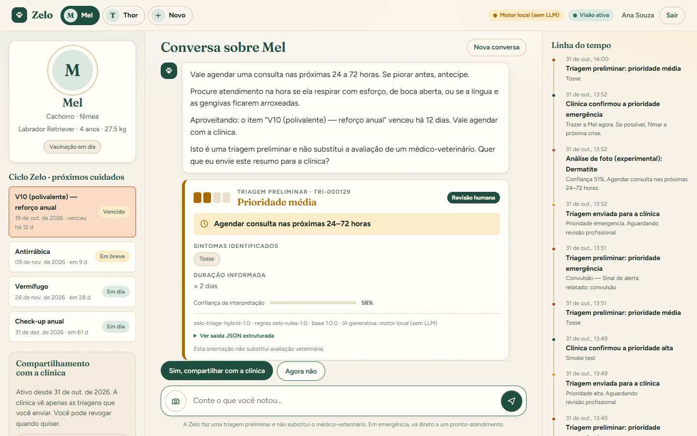
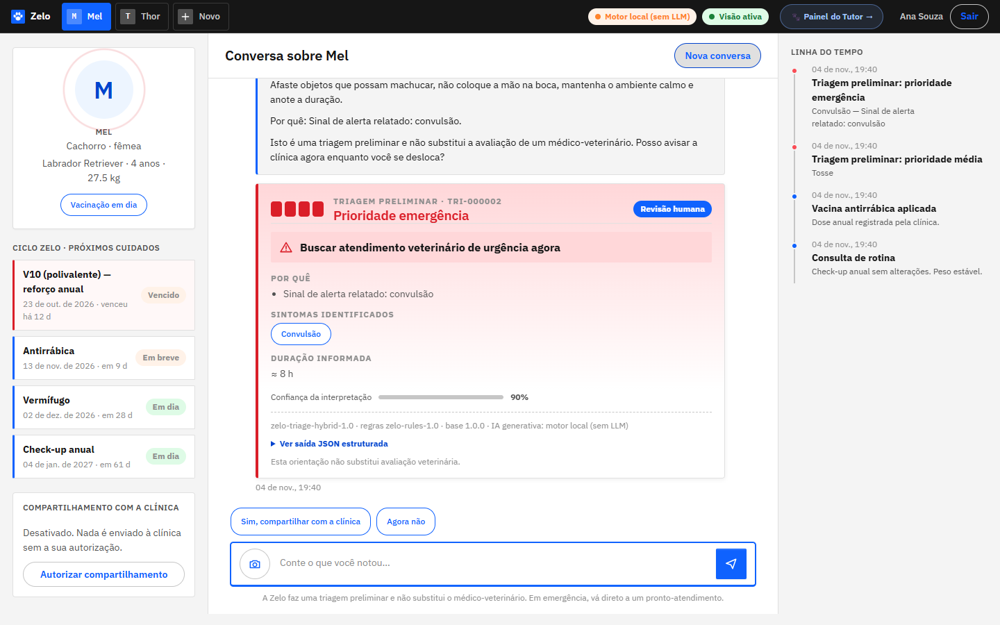
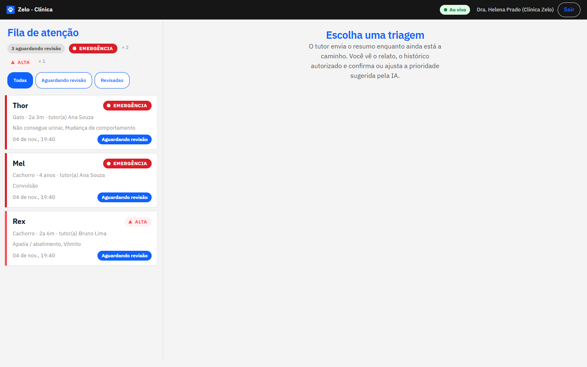

# Zelo — cuidado contínuo antes da urgência

> **Sprint 4 · Disruptive Architectures: IoT, IoB & Generative IA** — FIAP Challenge 2026 · Clyvo Vet
> Chatbot de triagem preliminar para pets: **HTML + Java (Spring Boot) + IA híbrida**, funcionando de ponta a ponta.

| | |
|---|---|
| **Vídeo pitch (YouTube, não listado)** | _inserir o link aqui antes de entregar_ |
| **Repositório** | https://github.com/marcusvilanova/Challenge_fiap_ZeloPet |
| **Integrantes** | Bruno Ferreira (RM 563489) · Gabriel Robertoni Padilha (RM 566293) · Hebert Lopes do Santos (RM 563192) · Marcus Vinícius Vila Nova da Silva (RM 558771) · Nicolas Monteiro Ramiro (RM 562380) |

---

## 1. O problema e a proposta

Tutores procuram ajuda quando a situação já virou urgência; entre uma consulta e outra, sintomas são mal interpretados e a clínica recebe informação fragmentada e tardia. O **Zelo** é um assistente que:

1. **entende o relato do tutor** em linguagem natural (sintomas, duração, contexto do pet);
2. **indica a prioridade** (baixa · média · alta · emergência) e o próximo passo — **sem diagnosticar e sem prescrever**;
3. **personaliza** com espécie, idade, histórico e plano de cuidados (Ciclo Zelo);
4. **avisa a clínica antes de o tutor chegar**, mas só com consentimento, e com **revisão humana** da prioridade.

A decisão clínica é sempre do médico-veterinário. A IA organiza e prioriza.

## 2. O que está implementado (Sprint 4)

| Componente | Tecnologia | Papel |
|---|---|---|
| **Chatbot do tutor** (`chat.html`) | HTML + CSS + JS (módulos ES, sem build) | Conversa, cartão de triagem, linha do tempo, plano de cuidados, consentimento, envio de foto |
| **Painel da clínica** (`clinic.html`) | idem | Fila ao vivo, relato do tutor, histórico autorizado, **revisão profissional** |
| **Backend** | Spring Boot 3.5 · Java 21 · Spring Security · Flyway · JPA | API REST, autenticação por perfil, persistência, orquestração |
| **Núcleo de triagem** | Java puro (`br.com.zelo.ai`) | Normalização, correção de digitação, extração de sintomas com **negação**, regras de segurança, confiança |
| **IA generativa** | SDK oficial `anthropic-java` · Claude | (opcional) extrai sintomas que o léxico não reconheceu e reescreve a resposta; tudo validado por um *guard* |
| **Visão computacional** | Python · FastAPI · ONNX Runtime · MobileNetV3 | Classificação **experimental** de doenças de pele em cães (D3) |
| **Dados** | Pipeline Python (D2) | Limpeza, normalização e catálogo canônico de 72 sintomas |

**Funciona sem chave de API:** sem `ANTHROPIC_API_KEY`, o motor local (regras + léxico) responde sozinho. Com a chave, o Claude entra como camada extra — e o motor determinístico continua sendo o **piso de segurança** (o LLM só pode *somar* sintomas ou reescrever o texto de prioridade baixa/média; nunca reduz a prioridade, e alta/emergência ficam sem reescrita).

Detalhes: [`docs/sprint4-ia.md`](docs/sprint4-ia.md) · [`docs/arquitetura.md`](docs/arquitetura.md) · [`docs/validacao-e-testes.md`](docs/validacao-e-testes.md) · [`docs/governanca-e-limitacoes.md`](docs/governanca-e-limitacoes.md) · [`docs/api.md`](docs/api.md)

## 3. Como executar

**Requisitos:** JDK 21+ (testado no 23) · Python 3.10+ · não precisa instalar Maven (usa o *wrapper*).

```powershell
# 1) Ambiente Python do serviço de visão (uma vez)
python -m venv ia\.venv
ia\.venv\Scripts\python -m pip install -r ia\requirements-service.txt

# 2) Tudo de uma vez: serviço de visão (porta 8001) + backend com o front-end (porta 8080)
.\scripts\run-local.ps1
```

Abra **http://localhost:8080**. Documentação interativa da API: **http://localhost:8080/swagger-ui.html** (exige login: entre no app antes).

Manualmente, em dois terminais:

```powershell
cd ia\vision\service; ..\..\.venv\Scripts\python -m uvicorn app:app --host 127.0.0.1 --port 8001
cd backend; .\mvnw.cmd spring-boot:run
```

### Contas de demonstração (dados fictícios; o `run-local.ps1` liga o seed, o backend sozinho vem com ele **desligado**)

| Perfil | E-mail | Senha |
|---|---|---|
| Tutora (pets: Mel — cadela, Thor — gato) | `ana@zelo.demo` | `zelo-demo-2026` |
| Tutor (pet: Rex — bulldog) | `bruno@zelo.demo` | `zelo-demo-2026` |
| Clínica | `vet@zelo.demo` | `zelo-demo-2026` |

> A senha acima é **somente de demonstração local**. Troque com `ZELO_DEMO_PASSWORD` ou desative os dados fictícios com `ZELO_SEED_DEMO=false`. Nada de segredo real fica no repositório.

### Variáveis de ambiente (ver `.env.example`)

| Variável | Padrão | Efeito |
|---|---|---|
| `ANTHROPIC_API_KEY` | _(vazia)_ | Ativa o LLM (Claude). Sem ela: motor local |
| `ZELO_LLM_PROVIDER` | `auto` | `local` força o motor local mesmo com chave |
| `ZELO_LLM_MODEL` | `claude-opus-5-5` | Modelo usado (ex.: `claude-haiku-5-5` para menor latência/custo) |
| `ZELO_VISION_URL` | `http://localhost:8001` | Serviço de visão; se estiver fora, o chat segue funcionando |
| `ZELO_SEED_DEMO` / `ZELO_DEMO_PASSWORD` | `false` / ver acima | Dados fictícios de demonstração (o `run-local.ps1` define `true`). Com cookies HTTPS, o app recusa subir com a senha padrão |
| `SPRING_DATASOURCE_URL/USERNAME/PASSWORD` | H2 em arquivo | Outro banco (ver `docs/governanca-e-limitacoes.md` sobre Oracle) |
| `ZELO_COOKIE_SECURE` | `false` | `true` atrás de HTTPS |

### Roteiro de 2 minutos para ver funcionando

1. Entre como **Ana** → escolha **Mel** → escreva: _"Ela está muito abatida e vomitou duas vezes desde ontem"_ → cartão **prioridade alta**.
2. Clique em **Sim, compartilhar com a clínica**.
3. Em outra janela, entre como **Clínica** → a triagem aparece na fila → **Confirmar** a prioridade com uma observação.
4. Volte à Ana: a **linha do tempo** mostra o retorno da clínica.
5. Em **Thor** escreva: _"Ele entra e sai da caixa de areia e só sai gotinha de xixi"_ → **emergência** (regra específica de gatos).
6. Em **Mel**, clique na câmera e envie `data/samples/d3/fungica_2.jpg` → análise **experimental** da pele (nem toda amostra sai certa: 3 das 12 saem erradas — ver limitações).

Verificação automática do fluxo completo (com o backend no ar):

```powershell
ia\.venv\Scripts\python -m pip install jsonschema
ia\.venv\Scripts\python scripts\smoke_test.py
```

## 4. Testes

```powershell
cd backend;  .\mvnw.cmd verify                # 195 testes (unidade + integração + conjunto-ouro) + cobertura JaCoCo
ia\.venv\Scripts\python -m pytest tests\ia    # 33 testes (pipeline de dados + serviço de visão)
```

Cobertura (JaCoCo): **94,7% das linhas**, 81,1% dos branches. O portão de qualidade clínico (`TriageGoldSetTest`) exige **recall de emergência = 100%**. Os números de generalização (e por que o 100% do conjunto de desenvolvimento não é o número a citar) estão em [`docs/validacao-e-testes.md`](docs/validacao-e-testes.md).

## 5. Resultados parciais (resumo honesto)

| Medida | Resultado | Observação |
|---|---|---|
| Cobertura do vocabulário do D2 | **81,2%** das menções viram sintoma canônico | 935 grafias brutas → 53 sintomas do catálogo (72 no total); 20 linhas duplicadas removidas |
| Triagem — conjunto **independente**, rodada 1 (antes de ajustar) | acurácia **75%** · recall de emergência **76,5%** | holdout, 56 casos |
| Triagem — conjunto **cego**, rodada 1 (antes de ajustar) | acurácia **60%** · recall de emergência **57%** | 35 casos; é a melhor estimativa **sem LLM** |
| Triagem — após ajustes do catálogo | 100% nos três conjuntos | **otimista**: viraram dados de desenvolvimento |
| Visão (D3) — validação cruzada agrupada por imagem-fonte | acurácia **82,2% ± 1,3** · macro-F1 0,77 | 6 classes; o split original tem vazamento (94,5% é inflado) |
| Modelo de visão | MobileNetV3 em ONNX, **11 MB** | classificação experimental, só cães |

Limitações, riscos e o que **não** foi feito (IoT/IoB, datasets D1/D4/D5, validação veterinária das regras): [`docs/governanca-e-limitacoes.md`](docs/governanca-e-limitacoes.md).

### Evidências (telas)

As 12 capturas estão em [`docs/evidencias/`](docs/evidencias/) (lista comentada em [`docs/sprint4-ia.md`](docs/sprint4-ia.md)). Três delas:

| Triagem média, com motivos e confiança | Emergência: sem perguntas, pede consentimento | Painel da clínica: fila por prioridade |
|---|---|---|
|  |  |  |

## 6. Estrutura do repositório

```
zelo-challenge/
├── README.md
├── backend/                    Spring Boot (API + front-end estático em src/main/resources/static)
│   └── src/main/java/br/com/zelo/{ai,chat,llm,vision,service,api,security,domain,repo,config}
├── ia/
│   ├── triage/                 catálogo de sintomas, pipeline do D2, conjuntos de avaliação (eval/)
│   ├── vision/{training,service}   treino do classificador (D3) e serviço FastAPI + ONNX
│   └── iob/                    (não implementado nesta sprint — ver README da pasta)
├── data/{samples,schemas}      amostras controladas (D2 limpo, 12 fotos do D3) e JSON Schema do contrato
├── docs/                       documentação técnica, relatórios, diagramas, evidências (telas), roteiro do vídeo
├── tests/ia/                   testes Python
└── scripts/                    run-local.ps1, smoke_test.py, capture_evidence.py, build-zip.ps1
```

Os datasets completos **não** estão no repositório (tamanho/licença): veja [`data/README.md`](data/README.md) para obtê-los e reproduzir o treino.

## 7. Contrato da saída de IA (resumo)

```json
{
  "triage_id": "TRI-000001", "pet_id": "PET-0001",
  "symptoms": ["apatia", "vomito"],
  "priority": "alta", "next_action": "contatar_clinica_veterinaria",
  "reason": "Abatimento junto de outros sinais indica que o organismo está sendo afetado",
  "confidence": 0.78, "model_version": "zelo-triage-hybrid-1.0",
  "engine": { "rules": "zelo-rules-1.0", "knowledge": "1.0.0", "llm": "local-fallback" },
  "human_review_required": true,
  "disclaimer": "Esta orientação não substitui avaliação veterinária."
}
```

Esquema completo: [`data/schemas/triage-result.schema.json`](data/schemas/triage-result.schema.json). Toda saída carrega `model_version`, `confidence`, `human_review_required` e `disclaimer`, e é persistida junto do evento (rastreabilidade).

## 8. Licenças e créditos

Fontes **Fraunces** e **Figtree** (SIL OFL 1.1, em `backend/src/main/resources/static/fonts/`). Datasets: ver `data/README.md` (D2 é parcialmente sintético, conforme a documentação do próprio dataset; o D4 cita o WAHIS/WOAH como fonte; confira as licenças de cada fonte antes de redistribuir).
