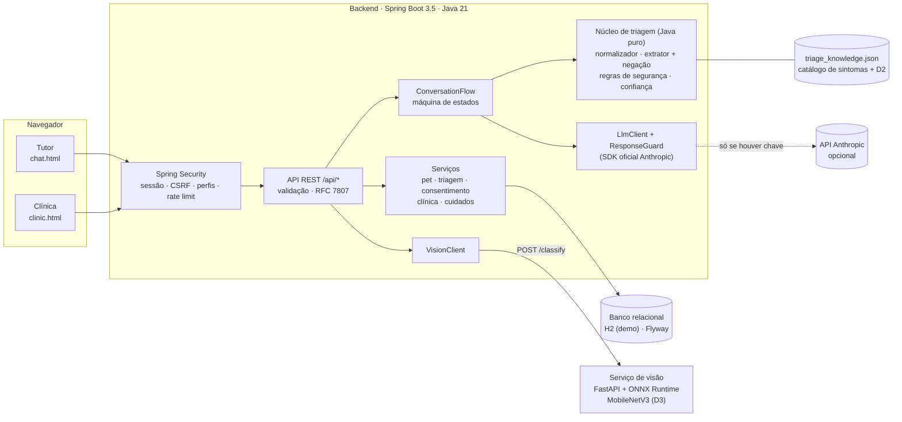
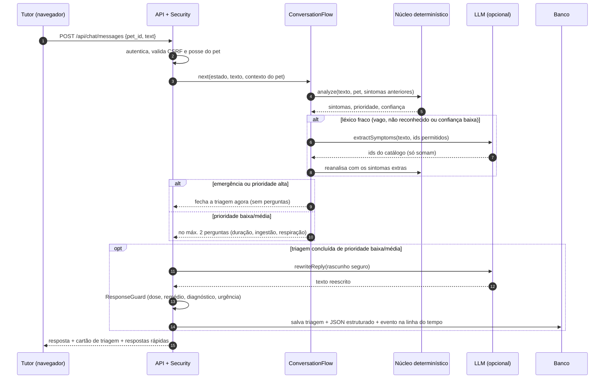
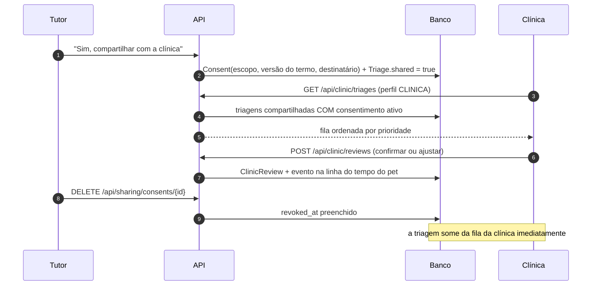
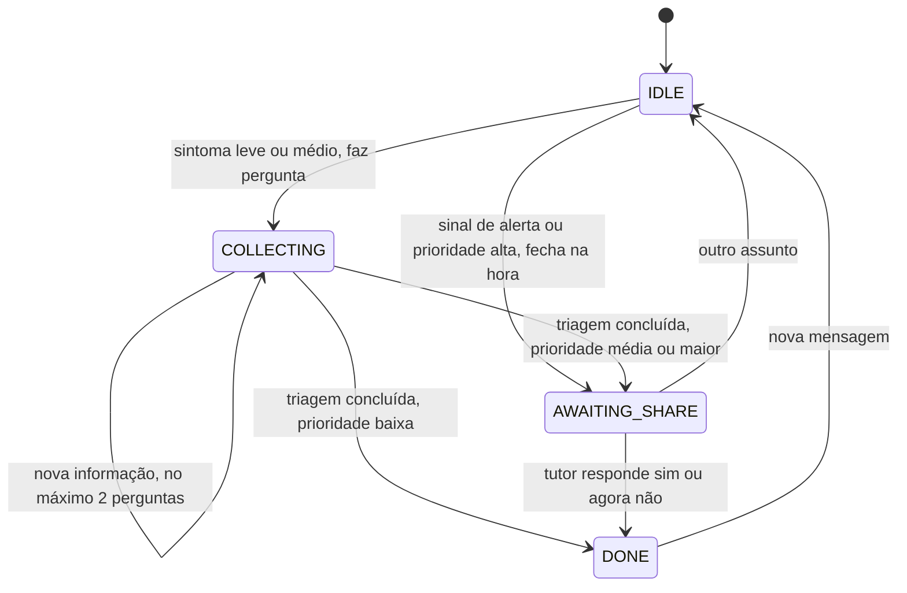
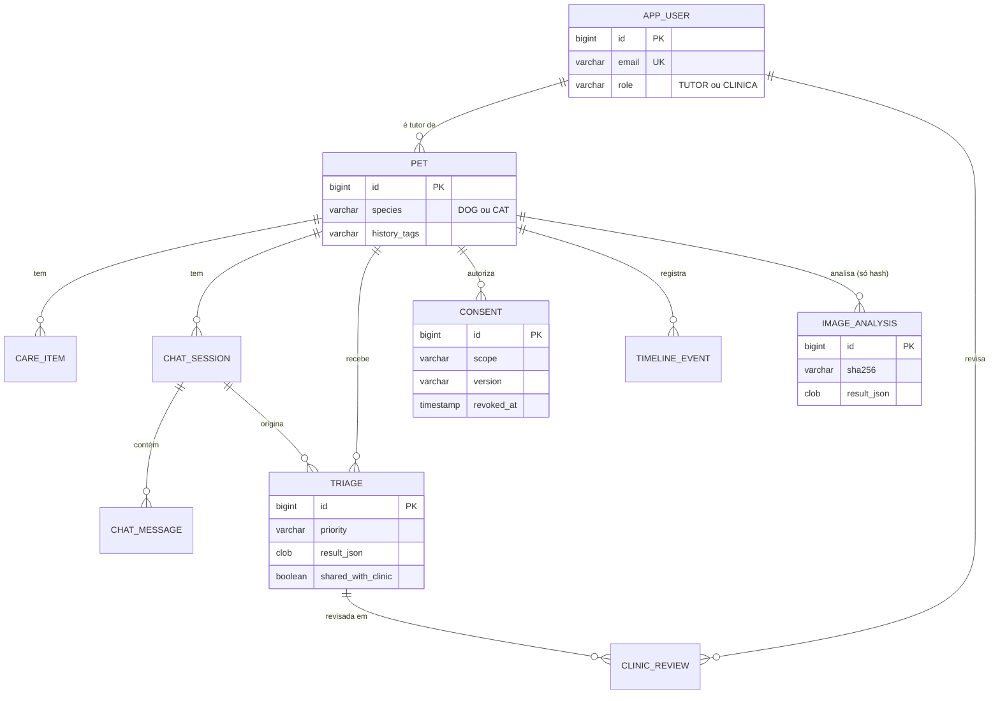

# Arquitetura do Zelo (Sprint 4)

Diagramas em Mermaid (renderizam no GitHub). Versão em imagem para slides/vídeo: [`diagramas/arquitetura.svg`](diagramas/arquitetura.svg).

## 1. Visão de componentes

**Princípios**

- O **núcleo determinístico** (`br.com.zelo.ai`) é Java puro: roda sem Spring, sem rede, e é testável em milissegundos.
- O **LLM é opcional e subordinado**: pode *somar* sintomas e *reescrever* o texto de prioridade **baixa/média**; nunca reduz a prioridade (o resultado determinístico é o piso). Alta/emergência não passam por reescrita, e toda reescrita passa por um `ResponseGuard`. Saudações, agradecimentos e respostas de sim/não nem chegam ao LLM.
- **Falha graciosa**: sem chave, sem serviço de visão ou com erro de rede, o chat continua respondendo pelo motor local.
- **Dados mínimos para a IA**: espécie, idade, raça, peso, histórico, nome do pet e o texto do relato, com e-mail, telefone, CPF e CEP mascarados. O nome do tutor não é enviado (mas nomes digitados no relato não são removidos).

## 2. Fluxo de uma mensagem do tutor

## 3. Compartilhamento com a clínica e revisão humana

## 4. Estados da conversa

## 5. Modelo de dados

DDL completo e versionado: `backend/src/main/resources/db/migration/V1__schema_inicial.sql` (Flyway).

## 6. Controle de acesso

| Rota | Anônimo | TUTOR | CLINICA |
|---|---|---|---|
| `/`, `/index.html`, `/css|js|fonts|img/**` | ✅ | ✅ | ✅ |
| `POST /api/auth/login`, `/api/auth/register` | ✅ | ✅ | ✅ |
| `/chat.html`, `/api/pets/**`, `/api/chat/**`, `/api/triage`, `/api/vision/**`, `/api/sharing/**` | 401 | ✅ (só os próprios dados) | 403 |
| `/clinic.html`, `/api/clinic/**` | 401 | 403 | ✅ (só triagens compartilhadas com consentimento ativo) |
| `/api/system/**`, `/api/auth/me` | 401 | ✅ | ✅ |

Acesso a pet/conversa/triagem de outro tutor devolve **404** (não 403), para não revelar a existência do recurso.

## 7. Decisões técnicas e por quê

| Decisão | Motivo |
|---|---|
| Triagem determinística como **camada primária** | Sprint 3: um LLM sozinho pode ser impreciso, não determinístico e confiante demais. Regras explícitas dão consistência clínica e auditoria. |
| LLM só **soma** sintomas / **reescreve** texto de baixa/média | Garante que nenhuma saída generativa reduza a prioridade; o guard barra dose, remédio, diagnóstico afirmado e perda de urgência. |
| "Sem sintoma reconhecido" ≠ "baixo risco" | Achado do conjunto cego: relatos fora do léxico geravam "baixa". Agora viram **média + revisão humana**. |
| SDK oficial da Anthropic | Evita reimplementar HTTP/retentativas; testado contra servidor falso (formato real da requisição). |
| Serviço de visão separado (Python/ONNX) | Mantém o backend Java leve e permite trocar/versionar o modelo sem tocar na experiência do usuário. |
| H2 + Flyway com SQL portável | Demo sem instalar banco; o grupo usa Oracle na outra disciplina (ver ressalvas em `governanca-e-limitacoes.md`). |
| Sessão + CSRF (cookie) em vez de JWT | Front-end estático same-origin: menos superfície de ataque, logout real e cookie `HttpOnly`/`SameSite`. |
